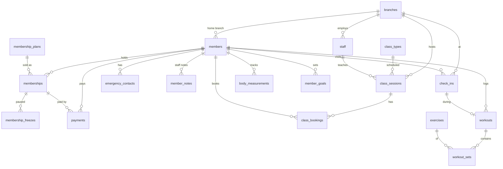

# Gym App — Customer Database

PostgreSQL 14+ schema for gym members: profiles, memberships & payments, visit history, class bookings, workout logs, body measurements and goals. Tested on PostgreSQL 16.

**New to the project? Start with the plain-language guide: [docs/DATABASE.md](docs/DATABASE.md).** This README is the quick technical reference.

## Files

| File | What it is |
|---|---|
| `schema.sql` | All 18 tables, constraints, triggers and views (schema `gym`) |
| `seed.sql` | Sample data: 2 branches, 3 staff, 3 plans, 3 members, check-ins, a class, a workout |
| `docs/DATABASE.md` | Plain-language guide: what's stored, the rules, what the backend owns, privacy |

## Setup

```bash
createdb gym
psql -d gym -f schema.sql
psql -d gym -f seed.sql      # optional, dev only
```

Everything lives in the `gym` schema. In your backend connection set `search_path=gym,public` (or prefix tables with `gym.`).

## Conventions (backend please read)

- **IDs** are UUIDs, safe to put in URLs. Members also get a short `member_number` for the front desk.
- **Money** is integer minor units: `24900` = ₪249.00. Never use floats. Currency defaults to `ILS`.
- **Times** are `timestamptz`. Send ISO-8601 with an offset; the DB stores UTC.
- **Status fields** are text with a CHECK list. Allowed values are in `schema.sql` next to each column.
- **Deleting a member** = set `deleted_at = now()`. Their email becomes free for a new signup; history stays. Always filter `WHERE deleted_at IS NULL` (the views already do).
- **Email** is case-insensitive (`Yossi@x.com` = `yossi@x.com`).
- **Auth**: either store a hash in `password_hash` (bcrypt/argon2, never plain text) or use an external provider and fill `auth_provider` + `auth_provider_uid`.
- **Card data**: never stored. Keep only the payment provider's transaction id in `payments.provider_ref`.

## Tables



| Area | Tables |
|---|---|
| People | `members`, `emergency_contacts`, `member_notes`, `staff`, `branches` |
| Billing | `membership_plans`, `memberships`, `membership_freezes`, `payments` |
| Visit history | `check_ins` |
| Classes | `class_types`, `class_sessions`, `class_bookings` |
| Training history | `exercises`, `workouts`, `workout_sets` |
| Progress | `body_measurements`, `member_goals` |

## Rules the database enforces for you

- A member can't have two overlapping live memberships (pending/active/frozen). Inserting one returns an exclusion-constraint error — show "member already has an active plan".
- Freezes on the same membership can't overlap.
- **Class booking**: just `INSERT` with status `booked`. If the class is full, the DB turns it into `waitlisted` with a `waitlist_position`. Read the returned row (`RETURNING status, waitlist_position`) to tell the user which happened.
- **Cancelling** a booking (`UPDATE ... SET status='cancelled'`) automatically moves the first waitlisted person to `booked` and sets `cancelled_at`. Backend should notify the promoted member.
- Payment webhooks are idempotent: the same `(provider, provider_ref)` can only be inserted once.
- `updated_at` is maintained automatically.

## Things the backend still owns

- Decrementing `memberships.visits_remaining` on check-in for punch-card plans.
- Marking memberships `expired` when `end_date` passes (a daily job), and creating the renewal + payment when `auto_renew` is true.
- Extending `end_date` when a freeze is added, if that's your gym's policy.
- Setting `checked_out_at` (or leaving it; occupancy ignores check-ins older than 12h).
- Marking bookings `attended` / `no_show` after the class.

## Ready-made views

| View | Use it for |
|---|---|
| `v_member_current_membership` | Profile screen + door check: plan, dates, `can_enter` (true/false) |
| `v_member_visit_stats` | Total visits, visits in last 30 days, last visit, average visit length |
| `v_branch_occupancy` | "How busy is the gym right now" |
| `v_personal_records` | Best weight / reps per exercise per member |

## Common queries

```sql
-- Door scan: can this card enter?
SELECT m.id, v.can_enter, v.plan_name, v.end_date
FROM members m JOIN v_member_current_membership v ON v.member_id = m.id
WHERE m.access_card_code = $1;

-- Check in
INSERT INTO check_ins (member_id, branch_id, membership_id, method)
VALUES ($1, $2, $3, 'qr') RETURNING id;

-- Member's visit history (paginated)
SELECT c.checked_in_at, c.checked_out_at, b.name AS branch
FROM check_ins c JOIN branches b ON b.id = c.branch_id
WHERE c.member_id = $1
ORDER BY c.checked_in_at DESC LIMIT 20 OFFSET $2;

-- Upcoming classes at a branch with spots left
SELECT s.id, t.name, s.starts_at, s.capacity,
       s.capacity - count(b.id) FILTER (WHERE b.status IN ('booked','attended')) AS spots_left
FROM class_sessions s
JOIN class_types t ON t.id = s.class_type_id
LEFT JOIN class_bookings b ON b.class_session_id = s.id
WHERE s.branch_id = $1 AND s.starts_at > now() AND s.status = 'scheduled'
GROUP BY s.id, t.name ORDER BY s.starts_at;

-- Book a class (tells you if you got waitlisted)
INSERT INTO class_bookings (class_session_id, member_id)
VALUES ($1, $2) RETURNING status, waitlist_position;

-- Workout history with sets
SELECT w.started_at, w.title, e.name, s.set_number, s.reps, s.weight_kg
FROM workouts w
JOIN workout_sets s ON s.workout_id = w.id
JOIN exercises e ON e.id = s.exercise_id
WHERE w.member_id = $1
ORDER BY w.started_at DESC, e.name, s.set_number;

-- Weight progress chart
SELECT measured_at, weight_kg, body_fat_pct
FROM body_measurements WHERE member_id = $1 ORDER BY measured_at;

-- Members whose plan ends in the next 7 days (renewal reminders)
SELECT * FROM v_member_current_membership
WHERE membership_status = 'active' AND end_date BETWEEN current_date AND current_date + 7;

-- Churn risk: active members with no visit in 14 days
SELECT v.member_id, v.first_name, v.last_name, s.last_visit_at
FROM v_member_current_membership v
JOIN v_member_visit_stats s USING (member_id)
WHERE v.can_enter AND (s.last_visit_at IS NULL OR s.last_visit_at < now() - interval '14 days');
```

## Privacy note

`members.health_notes`, `date_of_birth`, `body_measurements` and `emergency_contacts` are personal/health data. Only expose them to the member themselves and to staff who need them, and don't log them. Under Israel's Privacy Protection Law this DB likely needs to be treated as a registered database with access controls.
